<!-- ═══════════════════════  HEADER  ═══════════════════════ -->

  

  

  
  

<!-- ═══════════════════════  ABOUT  ═══════════════════════ -->
<h2> About Me</h2>

<table>
<tr>
<td width="55%" valign="top">

- 💻 Full-stack developer working across **React**, **Node.js / Express** and **Laravel**
- 🤖 Building **PathFinder AI** — an AI-powered career path & skill recommendation system for university graduates
- 🛒 Built **TechShop**, a full e-commerce platform with cart, checkout and an admin panel
- 🗄️ Comfortable with **PostgreSQL** and **MySQL**, REST APIs and JWT auth
- 🌱 Currently learning more about **AI integrations** and **cloud deployment**
- ⚡ Fun fact: I debug better after a cup of coffee ☕

</td>
<td width="45%" align="center">
  
</td>
</tr>
</table>

  

<!-- ═══════════════════════  TECH STACK  ═══════════════════════ -->
<h2>🛠️ Tech Stack</h2>

  <a href="https://skillicons.dev">
    
     
    
  </a>

<!-- ═══════════════════════  PROJECTS  ═══════════════════════ -->
<h2>🚀 Featured Projects</h2>

<table>
<tr>
<td width="50%" valign="top">

### 🧭 PathFinder AI
AI-powered career path & skill recommendation system. Graduates complete an assessment, get matched career suggestions with explanations, and a personal skill roadmap.

`React` `Node.js` `Express` `PostgreSQL` `OpenAI / Gemini` `JWT`

</td>
<td width="50%" valign="top">

### 🛒 [TechShop](https://github.com/nooraldeny3-svg/LaravelProject)
Electronics e-commerce web app with categories, search, session cart, checkout, order tracking, admin dashboard, role-based access and dark mode.

`PHP` `Laravel` `MySQL` `Breeze` `JavaScript`

</td>
</tr>
</table>

<!-- ═══════════════════════  STATS  ═══════════════════════ -->
<h2>📊 GitHub Stats</h2>

  
  

  

  

<!-- ═══════════════════════  SNAKE  ═══════════════════════ -->
<h2>🐍 Contribution Snake</h2>

  <picture>
    <source media="(prefers-color-scheme: dark)" srcset="https://raw.githubusercontent.com/nooraldeny3-svg/nooraldeny3-svg/output/github-snake-dark.svg"/>
    <source media="(prefers-color-scheme: light)" srcset="https://raw.githubusercontent.com/nooraldeny3-svg/nooraldeny3-svg/output/github-snake.svg"/>
    
  </picture>

<!-- ═══════════════════════  FOOTER  ═══════════════════════ -->

  

